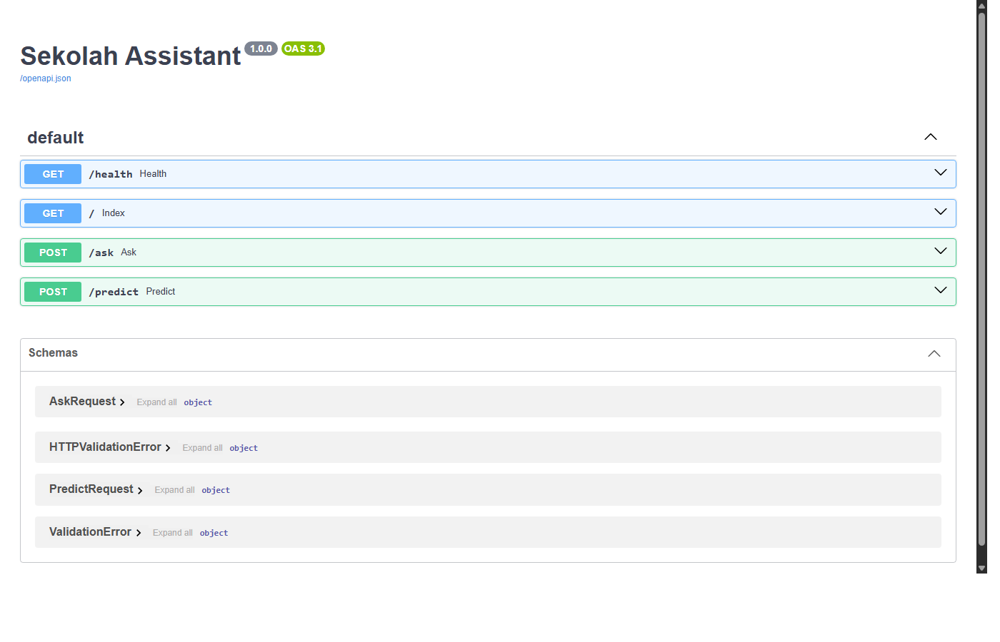
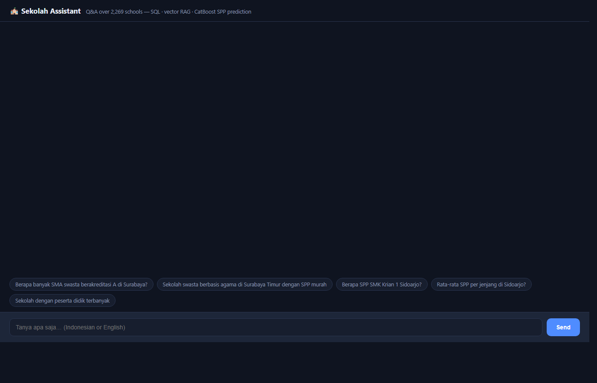
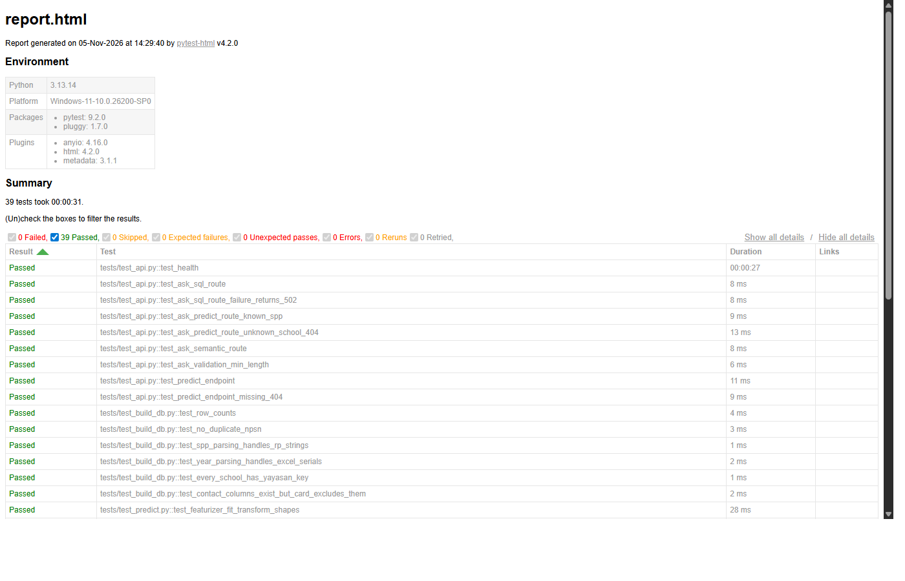

# 🏫 Tanya Sekolah

**Ask questions in plain Indonesian or English about 2,269 schools in Surabaya & Sidoarjo — and get the tuition estimate even for the ~87% of schools that never publish their fees.**

A complete data-to-LLM pipeline: government portals → Selenium scraping → SQLite + vector index → CatBoost tuition model → served as a natural-language Q&A application. No LangChain/LangGraph — the routing, text-to-SQL guard, and RAG glue are hand-written over the raw OpenAI-compatible SDK, so every step is inspectable.

[](https://github.com/AKARandy/tanya-sekolah/actions/workflows/ci.yml)  

---

## What is this project?

Indonesian school information is scattered across many website, among these are the four separate government portals that is but not limited to (Dapodik, data.kemendikdasmen, school profiles, the yayasan/foundation registry) with no unified API, and one of the most useful number for parents, **the monthly tuition (SPP)**, is almost never published online.

This project solves both halves of that problem:

1. **The data half** — Selenium scrapers unify the four portals into one dataset of 2,269 schools across two cities (Surabaya and Sidoarjo), covering identity, location, level, accreditation, facilities, staff, foundation ownership, land/electricity costs, and websites. Where the portals had no fee data, fees were collected manually, and a **CatBoost regression model predicts SPP** for everything else.

2. **The assistant half** — that dataset is served through an LLM application with three retrieval strategies, so a parent can ask *"sekolah swasta berbasis agama di Surabaya Timur dengan SPP murah"* or *"berapa SPP SMK Krian 1 Sidoarjo?"* in one chat box and get a cited, natural-language answer.

Built as an end-to-end project: scraping, feature engineering, model training with cross-validation, retrieval engineering, guarded LLM tooling, API serving, and testing.

> The original scraping notebooks and the Kaggle grid-search cross-validation scripts live in the companion repo: [InternProject-SPP_Sekolah](https://github.com/AKARandy/InternProject-SPP_Sekolah).

### Example interactions

| You ask | Assistant does | You get |
|---|---|---|
| "Berapa banyak SMA swasta berakreditasi A di Surabaya?" | **SQL route**: LLM writes a SELECT, executed read-only | A count, with the SQL shown |
| "Sekolah swasta berbasis agama di Surabaya Timur dengan SPP murah" | **Vector RAG**: embeds the question, retrieves top-5 school profile cards | Ranked suggestions with accreditation, size, foundation |
| "Berapa SPP SMK Krian 1 Sidoarjo?" | **Predict route**: looks up the school, finds real SPP → returns it directly | Rp220,000 (recorded data) |
| "Perkiraan SPP SD KHADIJAH 3 Surabaya?" | **Predict route**: no real SPP exists → CatBoost estimates from the school's features | An estimate, clearly labeled as model output |

The chat UI tags every answer with the route that produced it, so you can see which retrieval strategy is working.

---

## Architecture

```
                                  ┌─→ [SQL route]      LLM writes SELECT → guarded read-only
                                  │                     SQLite execution ────────────┐
user question → [Router LLM] ─────┤                                                  ├→ [Synthesis LLM]
                                  ├─→ [Vector RAG]     fastembed + ChromaDB top-k ───┤    → cited answer,
                                  │                     school profile cards          │     user's language
                                  └─→ [Predict route]  school lookup → CatBoost ──────┘
                                                        SPP estimate
```

**Router** (`app/router_agent.py`): one fast LLM call classifies the question into `sql | semantic | predict`. If the router or any backend fails, the app degrades to the semantic route and still returns raw evidence instead of an error.

**SQL route** (`app/sql_agent.py`): the LLM writes SQL, but the *application* enforces the security boundary: the SQLite connection is opened `mode=ro` (read-only at the file level), only single SELECT statements pass validation (no semicolons, comments, or DML), a row LIMIT is injected, and a failed query gets exactly one LLM repair round with the error message.

**Vector RAG** (`app/build_index.py`): each school becomes one Indonesian profile card (identity, location, accreditation, size, foundation, religion, tuition) embedded with `paraphrase-multilingual-MiniLM-L12-v2` via fastembed (ONNX — no torch dependency). Contact details (phones, emails, operator names) live in the database but are deliberately excluded from embeddings.

**Predict route** (`app/predict_spp.py`): wraps the CatBoost model. If a school has a recorded SPP it is returned as-is (labeled as real data); otherwise the model estimates it from the school's features and the answer says so.

---

## The data

| | |
|---|---|
| Schools | **2,269** — 1,897 Surabaya + 372 Sidoarjo |
| Foundations (yayasan) | 1,029 unique, with ownership grades |
| Levels | TK 1,067 · SD 403 · SMP 318 · SMA 139 · SMK 137 · KB 115 · others |
| Accreditation | A: 1,046 · B: 1,223 |
| Religious schools | 656 |
| With a website | 847 |
| **With a real recorded SPP** | **305 (13.4%)** — the rest get model estimates |

The tuition gap is the point: 86.6% of schools have no published fee anywhere, which is why the prediction model isn't a demo extra — it's the product feature.

Sources (all public):
- https://dapo.dikdasmen.go.id/
- https://data.kemendikdasmen.go.id/
- https://sekolah.data.kemendikdasmen.go.id/
- https://vervalyayasan.data.kemdikbud.go.id/

Data quality is ok for open-source Indonesian data on the internet, although there are rough edges everywhere (scraped numeric formats like `Rp220,000`, Excel serial dates, duplicated Sidoarjo rows across portals — all handled in `app/build_db.py`).

## The SPP model

- **Model**: CatBoostRegressor (handles the many categorical features natively), trained on log(SPP)
- **Features**: school profile (level, accreditation, size, teachers, rooms, labs), foundation profile (grade, number of schools under it), cost signals (land price per district, land area, electricity capacity and bill, school age), plus engineered ratios (rooms-per-m², electricity-per-room, fee-per-room)
- **Training data**: the clean merged frame of schools with known SPP (302 rows after filtering)
- **Validation**: the full grid search with k-fold cross-validation lives in the [companion repo's `train_cv.py`](https://github.com/AKARandy/InternProject-SPP_Sekolah) (designed for Kaggle GPU); the current served configuration is a fixed, fast-train variant. Cross-validated results from the notebook runs: **MAE ≈ Rp689k ± Rp292k on 10-fold CV**, a honest scale for a 300-row dataset, and usable for price-band estimates rather than exact quotes.

Trained a better model on Kaggle? Export it as `models/spp_model.pkl` in the format `{'model': ..., 'featurizer': ...}` and the app uses it with zero code changes; see `app/predict_spp.py`.

---

## Screenshots

Captured with **no LLM API key set** — the API, chat UI, and test suite all run keylessly; the key only upgrades raw-evidence fallbacks into natural-language answers.

| | |
|---|---|
|  | **`/docs`** — interactive OpenAPI docs for `POST /ask`, `POST /predict`, and `GET /health`, served by FastAPI at startup. |
|  | **Chat UI** — the static page at `/` (`static/index.html`) where you ask questions and see which route (SQL / vector RAG / prediction) answered. |
|  | **Test suite** — 39 tests passed in 31.44 s (`pytest --html`, full self-contained report: [docs/screenshots/pytest-report.html](docs/screenshots/pytest-report.html)). Tests mock the LLM, so they need no key and no network. |

---

## Running locally

Tested on Python 3.13, Windows, no Docker required.

```bash
git clone https://github.com/AKARandy/tanya-sekolah.git && cd tanya-sekolah

python -m venv .venv
# Windows: .venv\Scripts\activate   |   macOS/Linux: source .venv/bin/activate
pip install -r requirements.txt

# 1) LLM key: copy .env.example to .env and fill in LLM_API_KEY
#    (the app reads it via python-dotenv; see .env.example for LLM_PROVIDER and optional LLM_BASE_URL/LLM_MODEL)
cp .env.example .env

# 2) Data preparation — regenerates the gitignored artifacts (needs no key):
python -m app.build_db            # CSVs → schools.db (2,269 schools)
python -m app.build_index         # → chroma_db/ vector index (fastembed, downloads the model once)
python -m app.predict_spp --train # → models/spp_model.pkl (trains in seconds)

# 3) Serve:
uvicorn app.main:app --reload     # UI at http://127.0.0.1:8000, API docs at /docs
```

`GET /health` reports what's ready: without a key it returns `status: ok` with the configured `llm_base_url`; every LLM hop falls back to returning raw retrieval evidence, so the app demos end-to-end even keyless.

### LLM backends (all OpenAI-compatible, switch in `.env`)

| Provider | `LLM_PROVIDER` | Notes |
|---|---|---|
| Groq | `groq` | Recommended default: `llama-3.3-70b-versatile`, fast and handles Indonesian well |
| OpenRouter | `openrouter` | Free-tier alternative, many models |
| Ollama | `ollama` | Fully local, no key (`ollama pull llama3.1` first) |
| Qwen on Kaggle | `qwen-kaggle` | Self-hosted Qwen via a zrok tunnel — set `LLM_BASE_URL` (see [Qwen-on-Kaggle-via-zrok-and-API](https://github.com/AKARandy/Qwen-on-Kaggle-via-zrok-and-API)) |
| OpenAI | `openai` | Paid |
| Custom | `custom` | Any OpenAI-compatible URL + model id |

### API

| Endpoint | Purpose | Example body |
|---|---|---|
| `POST /ask` | Full Q&A pipeline (router → route → synthesis) | `{"question": "berapa SPP SMK Krian 1 Sidoarjo?"}` |
| `POST /predict` | Direct SPP estimate for one school | `{"school": "SMK KRIAN 1 SIDOARJO"}` |
| `GET /health` | Component status (DB rows, index, model artifact, LLM target) | — |

`/ask` responses include the `route` taken, the generated `sql` (SQL route), the `sources` (semantic route), or the `spp` + whether it's recorded vs predicted (predict route).

### Docker

```bash
cp .env.example .env && docker compose up   # builds DB + index + model on first start, serves :8000
```

### Testing & CI

```bash
python -m pytest tests/ -q   # 39 tests
ruff check app tests
```

The suite covers the SQL guard like a security boundary (mutation/comment/multi-statement rejection, read-only file proof), DB build correctness (row counts, dedup, `Rp220,000` parsing, Excel-serial dates), router fallbacks on malformed LLM output, featurizer train/inference parity, and the API with the LLM fully mocked. GitHub Actions runs lint + tests on every push.

---

## Honest limitations

- **The SPP model estimates price bands, not exact quotes**,300 training rows is small; treat predictions as ranges (see CV MAE above).
- **Predictions inherit scraping bias**, features come from public portal data; schools that maintain their portals look "richer" than they are.
- **Two cities only**, the pipeline generalizes, but the vector index and DB are built from Surabaya + Sidoarjo scrapes.
- **The router is a single LLM call**, misrouted questions fall back to semantic search rather than a correction loop.

## Project structure

```
app/
  build_db.py        # CSVs → schools.db (schema unification, Rp-string parsing, Excel dates)
  build_index.py     # profile cards → ChromaDB (fastembed, no torch)
  preprocessing.py   # cleaning + features shared by training & inference
  predict_spp.py     # CatBoost train/load/predict
  llm.py             # one OpenAI-compatible client factory (all backends)
  router_agent.py    # question → sql | semantic | predict
  sql_agent.py       # text-to-SQL + guarded read-only execution
  synthesis.py       # evidence → cited answer in the user's language
  main.py            # FastAPI: /ask /predict /health
static/index.html    # chat UI showing the active route
tests/               # 39 tests (SQL guard, data build, router, predictor, API)
```

## Credits

Data scraped from public Kemendikdasmen/Dapodik portals; feel free to use and/or modify the data and code — just credit the source if you publish it for work or something.
